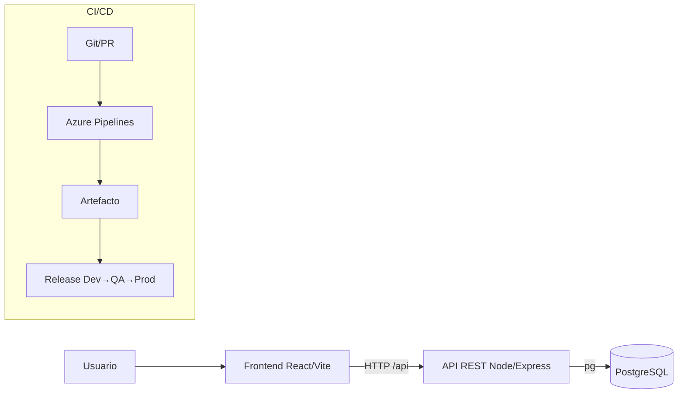

# Arquitectura

**Decisiones:** Express con rutas autocargadas desde `backend/src/routes`; reglas de negocio puras en `dominio.js` (probables sin BD); repositorio inyectable (`crearRepo(pool)` en producción, repositorio en memoria en pruebas); el frontend consume `/api` por proxy (Vite en dev, nginx en Docker).

**Modelo de datos:** `incidentes(id, titulo, descripcion, categoria, prioridad, usuario, tecnico, estado, creado_en, actualizado_en)` y `comentarios(id, incidente_id, autor, texto, creado_en)`.

**Estados:** NUEVO → ASIGNADO → EN_PROCESO → RESUELTO → CERRADO (RESUELTO puede volver a EN_PROCESO).
